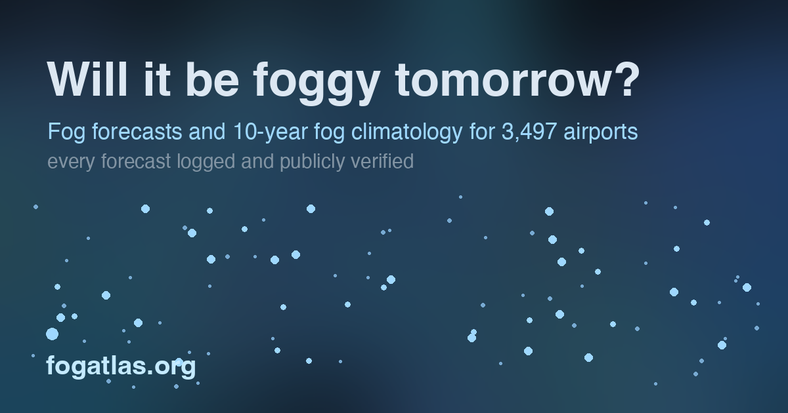
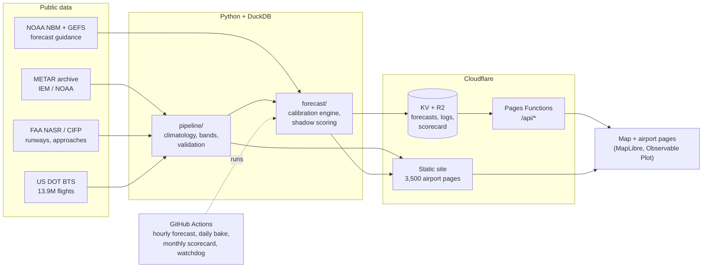

# Fog Atlas

**Will it be foggy tomorrow at the airport?** Fog Atlas answers that for about 3,500 airports worldwide, with a live fog map, a daily fog forecast, and ten years of fog history for each airport. Every forecast is logged and scored against what actually happened, and the results are published every month.

**Live site: [fogatlas.org](https://fogatlas.org)** · [Forecast scorecard](https://fogatlas.org/fog/scorecard/) · [Methodology](METHODOLOGY.md)

<!-- TODO: replace with a real screenshot or GIF of the map (save as docs/screenshot.png). The social card below is a stand-in. -->
[](https://fogatlas.org)

## Headline results

- **3,497 airports, 10 years of history.** Every hourly weather report (METAR) from 2016 to 2025 is sorted into visibility bands and summarized by airport, month and hour of day.
- **Checked against 13.9 million real flights.** Joined to US DOT records for 2023–2024, flights scheduled during hours the atlas flags as low-visibility were cancelled for weather at **5.2× the normal rate**. The bands mark hours that really do disrupt operations.
- **A forecast that is graded in public.** The engine recalibrates NOAA's National Blend of Models for each airport and runs in shadow mode. Every issuance is logged, and a monthly CI job scores it against observed weather. The latest scorecard covers about 13 million forecast–outcome pairs, with a pooled Brier skill of **+4.8% over climatology** (+11% in the first six hours). An airport shows a Fog Atlas percentage only after its own model has beaten its own climatology on live data, and 414 airports pass that bar today.

## Why it exists

Fog diverts flights. Big hubs handle it with CAT II/III instrument landing systems and autoland, but most airports don't have that equipment. Enhanced Flight Vision Systems (EFVS), infrared cameras that let pilots see the runway through fog, can recover many of those approaches. They're worth the most at airports that are often fogbound **and** lack CAT II/III. Fog Atlas maps that overlap from public data, and it gives pilots, operators and EFVS test crews a daily forecast to plan around.

## How it works



- **Climatology (`pipeline/`):** ingests ten years of METARs, classifies each observation into a visibility band, tags the cause (fog, mist, haze, smoke, snow), and cross-references each airport's approach capability. It writes static JSON for the map.
- **Forecast engine (`forecast/`):** runs every hour in GitHub Actions. It pulls NBM guidance, applies per-airport calibration fitted against ten years of METAR truth, and writes the issuance to Cloudflare KV, with the full log in R2. Once a day it rebuilds every airport page and redeploys the site.
- **Verification:** a monthly workflow scores every logged forecast against observed weather, publishes the scorecard at `/api/scorecard`, and commits the report to this repo. Each of those commits is a public, dated receipt.
- **Self-checking:** a watchdog workflow probes the live site and fails loudly if the forecast, the daily bake or the scorecard goes stale.

## Tech

**Data and modelling:** Python, DuckDB, Parquet, scikit-learn, NumPy. **Frontend:** TypeScript, Vite, MapLibre GL, Observable Plot. **Hosting:** Cloudflare Pages, Pages Functions, KV, R2. **Automation:** GitHub Actions (hourly forecast, daily site bake, monthly scorecard, monthly FAA reference refresh, watchdog).

## Run locally

The map runs from the static data committed in `app/public/data`:

```bash
cd app
npm install
npm run dev        # http://localhost:5173
```

The forecast engine and pipeline are Python 3.12:

```bash
pip install duckdb pandas numpy scikit-learn pyshp eccodes
python forecast/engine.py          # one forecast issuance → forecast/out/
python forecast/test_nws.py        # tests for the NWS forecast parser
```

The `/api/*` functions and the deploy steps need Cloudflare credentials. See `.github/workflows/` for the full production runbook.

## Repository layout

| Path | What's there |
|---|---|
| `app/` | Web app (Vite + TypeScript) and Cloudflare Pages Functions (`app/functions/api/`) |
| `forecast/` | Forecast engine, calibration fitting, shadow scoring, page builder |
| `pipeline/` | METAR ingestion, climatology aggregation, FAA reference data, flight-cancellation validation |
| `.github/workflows/` | Hourly forecast, monthly scorecard, reference refresh, watchdog |
| `METHODOLOGY.md` | Full methodology, thresholds, validation and caveats |

## The aviation details

Every METAR observation is classified into one of three visibility bands:

| Band | Prevailing visibility | Meaning |
|---|---|---|
| Normal ops | ≥ 800 m (½ SM) | Conventional CAT I approach workable |
| **EFVS-recoverable** | 300–800 m | Below typical CAT I minima, but within EFVS-usable range |
| Below all | < 300 m | Too low for EFVS too; CAT III autoland territory |

The site also has a **fog-chase board** and a **deployment planner** for EFVS flight-test crews. They use per-runway approach-lighting, RVR and minima filters from FAA NASR, a 3-minute live nowcast, and an estimated en-route time from a chosen home base.

## Data sources

- **METAR archive:** [Iowa Environmental Mesonet](https://mesonet.agron.iastate.edu/request/download.phtml) ASOS/METAR archive, backfilled from NOAA ISD where IEM coverage is thin.
- **Forecast guidance:** NOAA/NWS National Blend of Models and GEFS; NWS point forecasts and AWC TAFs, quoted with attribution.
- **Airports:** OurAirports open data.
- **CAT II/III and LPV capability:** FAA NASR and CIFP for US airports; a hand-curated list for international airports (see the methodology for confidence levels).
- **Cancellations (US validation):** US DOT Bureau of Transportation Statistics on-time performance data.

## Honest limitations

METAR prevailing visibility is a proxy for runway visual range (RVR), not a substitute. Band thresholds are global approximations, not per-runway minima. Station data quality varies outside the US. CAT II/III flags outside the US are curated, not authoritative. The BTS "weather" cancellation code covers all weather, not only fog. Fog Atlas is not for operational use. Full methodology and assumptions are in [`METHODOLOGY.md`](METHODOLOGY.md).
